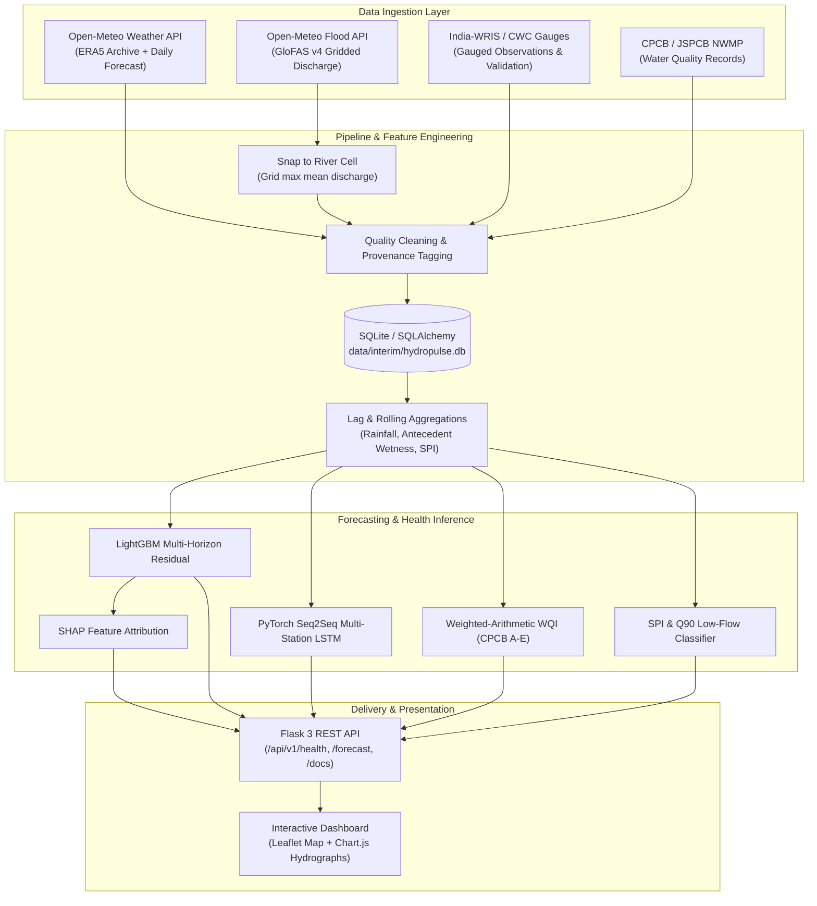

# HydroPulse AI — Jharkhand River Health Monitoring System

> **Advisory Warning & Disclaimer**  
> HydroPulse AI is an experimental AI/ML research and advisory decision-support system for the Damodar and Subarnarekha basins in Jharkhand. **Official flood alerts and river level warnings are issued exclusively by the Central Water Commission (CWC) and Jharkhand State Disaster Management Authority (JSDMA).**

---

## 1. Problem Statement
River basins in Jharkhand (principally the **Damodar** and **Subarnarekha**, alongside key tributaries such as the Konar, Barakar, and Kharkai) face dual environmental vulnerabilities:
1. **Severe Flash & Monsoon Flooding**: Sudden extreme discharge events driven by intense monsoon rainfall, complex terrain in the Chota Nagpur plateau, and upstream reservoir releases (Tenughat, Maithon, Panchet, Chandil).
2. **Drought & Industrial Water Stress**: Chronic low-flow periods alternating with severe water-quality degradation in the mining and industrial corridors (Bokaro, Dhanbad coalfields, Jamshedpur industrial belt).

HydroPulse AI addresses these challenges with an integrated platform providing:
- Multi-horizon discharge forecasts (1 to 7 days ahead) with calibrated uncertainty bounds (P10/P50/P90).
- Drought and low-flow tracking (SPI-1, SPI-3, SPI-6 gamma-fitted precipitation indices and Q90 low-flow stress).
- River health scoring using weighted-arithmetic Water Quality Index (WQI) categorized into CPCB designated-best-use classes (A–E).
- Transparent explainability ("Why is this station in alert?") and full data provenance tagging.

---

## 2. System Architecture



---

## 3. Repository Layout

```
config/            stations.yaml, thresholds.yaml, settings.py
data/{raw,interim,processed,events}/   (gitignored except events + samples)
src/hydropulse/
  ingest/          openmeteo_weather.py, openmeteo_flood.py, wris_cwc.py, cpcb_wq.py
  features/        cleaning.py, lags.py, spi.py, static_attrs.py
  models/          baselines.py, lgbm.py, lstm.py, quantile.py, wqi.py, drought.py
  evaluation/      metrics.py, events.py, plots.py
  pipeline/        train.py, predict.py, refresh.py
  api/             app factory, blueprints, schemas, docs
  web/             templates/, static/
tests/             pytest unit, contract, and leakage tests
docs/              ARCHITECTURE.md, DATA_CARD.md, MODEL_CARD.md, LIMITATIONS.md
reports/           runs/, metrics.json
```

---

## 4. Quickstart

### Prerequisites
- Python 3.11+
- Git

### Local Setup
```bash
# 1. Clone repository
git clone https://github.com/OMKR01/HydroPulse-AI.git
cd HydroPulse-AI

# 2. Setup virtual environment and dependencies
python -m venv venv
# Linux / macOS:
source venv/bin/activate
# Windows:
venv\Scripts\activate

# 3. Install dependencies and package in editable mode
pip install -r requirements-dev.txt
pip install -e .

# 4. Run tests and linting
pytest
ruff check .

# 5. Start application
python -m src.hydropulse.api.factory
```
Open [http://localhost:5000/docs](http://localhost:5000/docs) in your browser for the interactive OpenAPI documentation and [http://localhost:5000/api/v1/health](http://localhost:5000/api/v1/health) for the health check.

---

## 5. Development Automation
Using `make` (or `make.bat` on Windows):
```bash
make setup    # Install dependencies
make lint     # Run ruff check and format check
make format   # Automatically format code
make test     # Run pytest suite with coverage
make run      # Launch Flask development server
```

---

## 6. Feature Pipeline & Exploratory Analysis
- **Parquet Datasets**: Feature datasets with leak-free lags, rolling moisture sums, SPI indices, and static catchment attributes are exported to `data/processed/*.parquet`:
  ```bash
  python -c "from src.hydropulse.features.builder import build_all_processed_datasets; build_all_processed_datasets()"
  ```
- **Exploratory Analysis**: The notebook [`notebooks/01_eda.ipynb`](notebooks/01_eda.ipynb) delivers top-to-bottom analysis of:
  1. Topographical contrast between Damodar (mining/regulated) and Subarnarekha (plateau/industrial).
  2. Monsoon concentration and baseline discharge profiles.
  3. Rainfall-to-discharge cross-correlation lead times (1–3 days).
  4. Non-destructive outlier audit and provenance breakdown (`model_reanalysis`, `forecast`, `observed`).

---

## 7. Docker Deployment
```bash
docker compose up --build
```

---

## 8. Model Metrics & Evaluation Discipline
Per project integrity rules, all metrics are strictly generated by automated evaluation scripts into `reports/metrics.json` and read programmatically. No metrics are hand-typed.
Baseline comparison table will populate upon completion of Phase 3.
