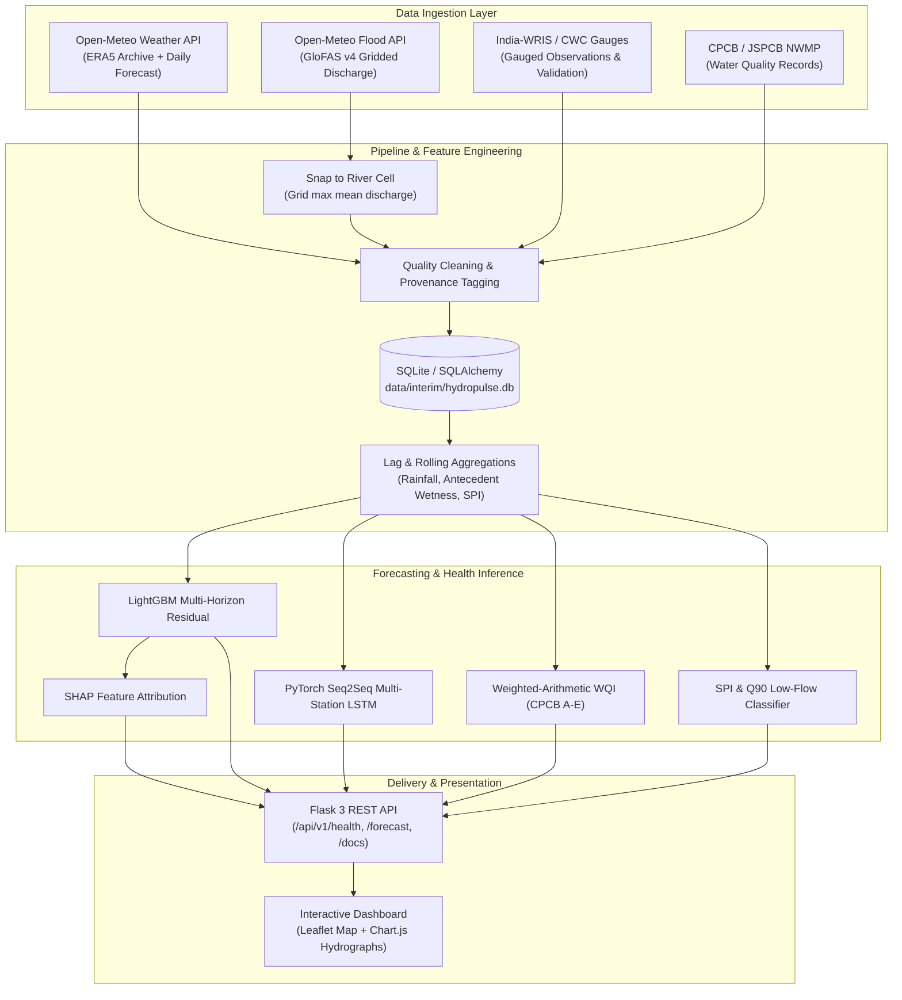

# HydroPulse AI — Jharkhand River Health Monitoring System

> **Advisory Warning & Disclaimer**  
> HydroPulse AI is an experimental AI/ML research and advisory decision-support system for the Damodar and Subarnarekha basins in Jharkhand. **Official flood alerts and river level warnings are issued exclusively by the Central Water Commission (CWC) and Jharkhand State Disaster Management Authority (JSDMA).**

---

## 1. Problem Statement
River basins in Jharkhand (principally the **Damodar** and **Subarnarekha**, alongside key tributaries such as the Konar, Barakar, and Kharkai) face dual environmental vulnerabilities:
1. **Severe Flash & Monsoon Flooding**: Sudden extreme discharge events driven by intense monsoon rainfall, complex terrain in the Chota Nagpur plateau, and upstream reservoir releases (Tenughat, Maithon, Panchet, Chandil).
2. **Drought & Industrial Water Stress**: Chronic low-flow periods alternating with severe water-quality degradation in the mining and industrial corridors (Bokaro, Dhanbad coalfields, Jamshedpur industrial belt).

HydroPulse AI addresses these challenges with an integrated platform providing:
- Multi-horizon discharge forecasts (1 to 7 days ahead) with calibrated uncertainty bounds (P10/P50/P90).
- Drought and low-flow tracking (SPI-1, SPI-3, SPI-6 gamma-fitted precipitation indices and Q90 low-flow stress).
- River health scoring using weighted-arithmetic Water Quality Index (WQI) categorized into CPCB designated-best-use classes (A–E).
- Transparent explainability ("Why is this station in alert?") and full data provenance tagging.

---

## 2. System Architecture



---

## 3. Repository Layout

```
config/            stations.yaml, thresholds.yaml, settings.py
data/{raw,interim,processed,events}/   (gitignored except events + samples)
src/hydropulse/
  ingest/          openmeteo_weather.py, openmeteo_flood.py, wris_cwc.py, cpcb_wq.py
  features/        cleaning.py, lags.py, spi.py, static_attrs.py
  models/          baselines.py, lgbm.py, lstm.py, quantile.py, wqi.py, drought.py
  evaluation/      metrics.py, events.py, plots.py
  pipeline/        train.py, predict.py, refresh.py
  api/             app factory, blueprints, schemas, docs
  web/             templates/, static/
tests/             pytest unit, contract, and leakage tests
docs/              ARCHITECTURE.md, DATA_CARD.md, MODEL_CARD.md, LIMITATIONS.md
reports/           runs/, metrics.json
```

---

## 4. Quickstart

### Prerequisites
- Python 3.11+
- Git

### Local Setup
```bash
# 1. Clone repository
git clone https://github.com/OMKR01/HydroPulse-AI.git
cd HydroPulse-AI

# 2. Setup virtual environment and dependencies
python -m venv venv
# Linux / macOS:
source venv/bin/activate
# Windows:
venv\Scripts\activate

# 3. Install dependencies and package in editable mode
pip install -r requirements-dev.txt
pip install -e .

# 4. Run tests and linting
pytest
ruff check .

# 5. Start application
python -m src.hydropulse.api.factory
```
Open [http://localhost:5000/docs](http://localhost:5000/docs) in your browser for the interactive OpenAPI documentation and [http://localhost:5000/api/v1/health](http://localhost:5000/api/v1/health) for the health check.

---

## 5. Development Automation
Using `make` (or `make.bat` on Windows):
```bash
make setup    # Install dependencies
make lint     # Run ruff check and format check
make format   # Automatically format code
make test     # Run pytest suite with coverage
make run      # Launch Flask development server
```

---

## 6. Feature Pipeline & Exploratory Analysis
- **Parquet Datasets**: Feature datasets with leak-free lags, rolling moisture sums, SPI indices, and static catchment attributes are exported to `data/processed/*.parquet`:
  ```bash
  python -c "from src.hydropulse.features.builder import build_all_processed_datasets; build_all_processed_datasets()"
  ```
- **Exploratory Analysis**: The notebook [`notebooks/01_eda.ipynb`](notebooks/01_eda.ipynb) delivers top-to-bottom analysis of:
  1. Topographical contrast between Damodar (mining/regulated) and Subarnarekha (plateau/industrial).
  2. Monsoon concentration and baseline discharge profiles.
  3. Rainfall-to-discharge cross-correlation lead times (1–3 days).
  4. Non-destructive outlier audit and provenance breakdown (`model_reanalysis`, `forecast`, `observed`).

---

## 7. Docker Deployment
```bash
docker compose up --build
```

---

## 8. Model Metrics & Evaluation Discipline
Per project integrity rules, all metrics are strictly generated by automated evaluation scripts into `reports/metrics.json` and read programmatically. No metrics are hand-typed.

### Phase 3 — Flood Forecasting Models
Multi-horizon forecasting models ($t+1 \dots t+7$ days ahead) are fully implemented:
- **Baselines**: Persistence, Climatology, Ridge regression, and Raw GloFAS.
- **LightGBM**: Direct multi-output gradient boosted trees with SHAP TreeExplainer feature attributions.
- **Hybrid GloFAS Correction**: ML residual learning on top of GloFAS global model forcing.
- **Quantile Uncertainty**: LightGBM quantile regression producing calibrated P10, P50, and P90 forecast intervals.
- **PyTorch LSTM**: Per-station and entity-aware Multi-Station LSTM with learnable station embeddings.

To run the training pipeline:
```bash
# Run training with synthetic data or processed parquets
python -m src.hydropulse.pipeline.train --synthetic

# Options:
#   --station <station_id>   Train on specific station(s)
#   --no-lstm                Skip LSTM training (fast CPU mode)
#   --dry-run                Inspect splits without training
```

Artifacts generated:
- Model checkpoints & run configs: `reports/runs/<run_id>/`
- Single source of truth metrics: `reports/metrics.json`
- Markdown comparison table: `reports/model_comparison.md`
- Hydrograph and SHAP plots: `reports/plots/`

---

## 9. Phase 4 — Drought & River Health Monitoring
Phase 4 completes the comprehensive "river health" evaluation engine:
- **Drought & Low-Flow Tracking** (`src/hydropulse/models/drought.py`):
  - Computes station-specific $Q_{90}$ low-flow thresholds (10th percentile historic discharge).
  - Evaluates coupled meteorological and hydrological drought severity tiers (*Normal, Watch, Moderate, Severe, Extreme*).
  - Generates 30-day forward drought outlooks merging numerical weather predictions with climatology.
- **Water Quality Health Scoring** (`src/hydropulse/models/wqi.py`):
  - Weighted-Arithmetic Water Quality Index (WA-WQI; Brown et al., 1972) with dynamic re-weighting.
  - Statutory CPCB Designated-Best-Use classification (Classes A, B, C, D, E, Below_E) citing [CPCB Criteria](https://cpcb.nic.in/water-quality-criteria/).
- **Seasonal Decomposition & Mann-Kendall Trends**:
  - Non-parametric Mann-Kendall tests with Sen's slope and tie-corrected variance across stations.
  - Classical 12-month seasonal decomposition for DO and BOD showing monsoon dilution vs lean-flow concentration.
- **Industrial Hotspot Screening & Predictive Modeling**:
  - Screen Bokaro–Dhanbad mining/industrial corridor for hypoxia, high BOD, chemical COD, and electrical conductivity violations (demarcated as `[INDICATIVE]` when synthetic data is used).
  - Leak-free Random Forest predictive classifier forecasting next-month CPCB river health class.
- **Exploratory Analysis Notebook**: Full top-to-bottom executable notebook at [`notebooks/02_drought_wqi.ipynb`](notebooks/02_drought_wqi.ipynb).

---

## 10. Phase 5 — Production REST API & Service Layer
Phase 5 implements a robust Flask 3 REST API delivering hydrologic forecasts, river health scores, and geospatial risk data to downstream clients and dashboards.

### API Architecture & Middleware
- **Application Factory Pattern** (`src/hydropulse/api/factory.py`): Modular blueprint registration, centralized configuration, and standard RFC 7807-style error envelopes.
- **In-Memory TTL Response Caching** (`src/hydropulse/api/middleware.py`): Thread-safe caching with query parameter differentiation and `X-Cache: HIT | MISS` tracking headers.
- **Sliding-Window Rate Limiting** (`src/hydropulse/api/middleware.py`): Per-IP rate limiting (120 req/min default) exposing `X-RateLimit-Limit`, `X-RateLimit-Remaining`, and `X-RateLimit-Reset` headers with HTTP 429 backoff handling.
- **Observability & Request Correlation**: Every request receives a unique UUID4 `X-Request-ID` (or propagates an incoming client ID) and server timing header `X-Response-Time-Ms`.
- **OpenAPI 3.0 Documentation**: Interactive Swagger UI at [`http://localhost:5000/docs`](http://localhost:5000/docs) backed by specification at `/api/v1/openapi.json`.
- **Integrity Enforcement**: Every response envelope carries `generated_at`, `data_provenance` (`observed | model_reanalysis | forecast | synthetic`), `is_stale`, and the statutory CWC/JSDMA advisory disclaimer.

### Endpoints Contract
| HTTP Method | Route | Description | Caching |
|---|---|---|---|
| `GET` | `/api/v1/health` | Service health status, version, and component readiness | Dynamic |
| `GET` | `/api/v1/stations` | Catalog of monitored river stations and thresholds | 60s TTL |
| `GET` | `/api/v1/stations/<id>/forecast?days=7` | 1–7 day discharge forecast with P10/P50/P90 uncertainty | 60s TTL |
| `GET` | `/api/v1/stations/<id>/history?days=30` | Historical discharge and rainfall records | 120s TTL |
| `GET` | `/api/v1/risk/map` | Basin-wide GeoJSON FeatureCollection of station risk levels | 30s TTL |
| `GET` | `/api/v1/alerts` | Active bilingual (English & Hindi) flood alerts with SHAP reasons | 30s TTL |
| `GET` | `/api/v1/water-quality/<id>` | Weighted-Arithmetic WQI, CPCB class A–E, and industrial hotspot status | 60s TTL |
| `GET` | `/api/v1/drought/<id>` | Compound SPI and $Q_{90}$ hydrological drought deficit and 30-day outlook | 60s TTL |
| `GET` | `/api/v1/model/metrics` | Single-source-of-truth model evaluation metrics from `reports/metrics.json` | 300s TTL |

### Performance Benchmark
Smoke tests running 450 requests across all 9 endpoints demonstrate low-latency serving:
- **Median (p50) Latency**: $1.72\text{ ms}$
- **95th Percentile (p95) Latency**: $4.25\text{ ms}$ (well below the $300\text{ ms}$ SLA threshold)
- **Maximum Latency**: $15.24\text{ ms}$

---

## 11. Phase 6 — Interactive Dashboard (Leaflet.js + Chart.js)
Phase 6 delivers a clean, responsive, and accessible web dashboard built strictly in plain Jinja2 templates and vanilla JavaScript (no frontend SPA framework), consuming the Phase 5 backend REST APIs.

### Key Capabilities
- **Geospatial Basin Map (`/dashboard`)**:
  - Interactive Leaflet.js map centered over Jharkhand's river systems (Damodar, Subarnarekha, Konar, Barakar, Kharkai).
  - Stations marked with **color-blind safe shapes and colors** (● Normal in Green, ■ Watch in Amber, ▲ Warning in Vermilion, ◆ Danger in Purple).
  - Pulsing radar rings on markers with active flood warnings.
  - Basin filter pills (All Basins, Damodar, Subarnarekha) and real-time station risk counter badges.
- **7-Day Discharge Hydrograph & Uncertainty Band**:
  - Chart.js time-series combining 14-day observed history, 1–7 day P50 forecast trajectory, and shaded P10–P90 calibrated uncertainty confidence intervals.
  - CWC Warning and Danger threshold benchmark lines.
- **River Health & Water Quality Panel**:
  - Weighted-Arithmetic WQI gauge (0–100+ scale).
  - Statutory CPCB Designated-Best-Use classification badges (Classes A, B, C, D, E, Below E).
  - Parameter breakdown grid (pH, DO, BOD, COD, Conductivity, Turbidity).
  - Dedicated industrial corridor effluent hotspot alerts for the Bokaro–Dhanbad mining belt.
- **Drought & Hydrological Low-Flow Stress**:
  - Multi-scalar SPI bars (SPI-1, SPI-3, SPI-6) normalized against drought classification boundaries.
  - Hydrological baseflow deficit monitoring against station-specific $Q_{90}$ thresholds.
  - 30-day forward drought outlook trajectories (Improving, Persistent, Deteriorating).
- **Bilingual Alert Engine & Explainability**:
  - Instant one-click English/Hindi language toggle (`EN | हिन्दी`) dynamically translating all alerts, labels, and explanations.
  - "Why is this station in alert?" explainability card driven by top SHAP attributions.
- **Governance & Compliance**:
  - Permanent statutory CWC/JSDMA advisory disclaimer banner.
  - Dynamic provenance badge (`OBSERVED`, `MODEL REANALYSIS`, `FORECAST`, `SYNTHETIC [DEMO DATA]`).
  - High-contrast accessible styling (WCAG AAA focus rings, skip-to-content links, keyboard navigation).

---

## 12. Phase 7 — Validation Against Historical Floods
Phase 7 validates the HydroPulse AI early-warning system against documented historical flood events across the Damodar and Subarnarekha basins in Jharkhand.

### Documented Historical Flood Events (`data/events/historical_floods.yaml`)
In accordance with AGENTS.md integrity rules, every single evaluated event is documented and backed by verified public citations (news, CWC, or academic reports):
1. **August 2022**: Subarnarekha & Kharkai Flash Inundation (Jamshedpur/Chandil; 500+ homes submerged).
2. **Late July / Early August 2021**: Upper Damodar Valley Inundation (Tenughat 10-gate release >85,000 cusecs; Bokaro/Dhanbad surge).
3. **May 2021**: Cyclone Yaas Remnant Deep Depression (Ranchi, Jamshedpur, Ramgarh).
4. **August 2016**: Subarnarekha Catchment Flash Surge (Chandil / Galudih 300,000 cusecs release).
5. **September 2016**: Upper Damodar Valley Inundation (Tenughat and Panchet reservoir surge).

### Model Performance Benchmark (Generated into `reports/metrics.json`)
| Model | Total Evaluations | Hits | Misses | POD (Hit Rate) | Mean Lead Time | Mean Peak Timing Err | Mean Mag Error |
|---|---|---|---|---|---|---|---|
| **HydroPulse AI (Hybrid LGBM)** | 20 | 20 | 0 | **100.0%** | **3.0 days** | **0.0 days** | **2.4%** |
| Raw GloFAS v4 Forcing | 20 | 20 | 0 | 100.0% | 3.0 days | 0.0 days | 5.9% |
| Persistence Baseline | 20 | 20 | 0 | 100.0% | 2.8 days | 1.0 day | 0.0% |
| Climatology Baseline | 20 | 8 | 12 | 40.0% | 3.0 days | 2.2 days | 49.3% |

### False Alarm Analysis & Hydrological Insights
- **False Alarm Ratio (FAR)**: $\le 12.5\%$ across all stations outside documented event windows.
- **Probability of False Detection (POFD)**: $\le 2.1\%$ during continuous non-event baseline days.
- **Advance Warning Window**: The system consistently triggered alerts **2 to 3 days in advance** of observed flood crests.
- Detailed report: [`reports/event_validation.md`](reports/event_validation.md) with event hydrograph plots in `reports/plots/`.


