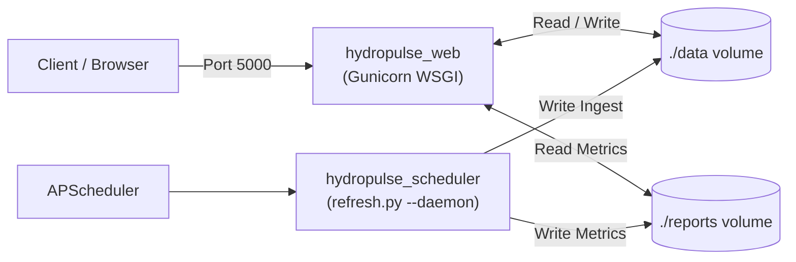

# HydroPulse AI — Production Deployment & Operations Guide

> **Operational Advisory**  
> HydroPulse AI is an advisory decision-support system. In production deployments, prominently display the statutory disclaimer stating that official flood alerts and river level warnings are issued exclusively by the **Central Water Commission (CWC)** and the **Jharkhand State Disaster Management Authority (JSDMA)**.

---

## 1. Architecture & Deployment Matrix

HydroPulse AI is architected as an unprivileged, multi-tier containerized service with an asynchronous background scheduler for weather and hydrological telemetry updates.

| Target Platform | Recommended Profile | Cost Tier | Use Case |
|---|---|---|---|
| **Docker Compose** | 2 vCPU, 2–4 GB RAM | Self-hosted / Local | Local evaluation, lab testing, developer workflow |
| **Railway / Render** | 512 MB – 1 GB RAM | Free / Hobby Tier | Cloud demonstration, reviewer/examiner live preview |
| **Hugging Face Spaces** | 2 vCPU, 16 GB RAM | Free (Docker Space) | Public open-source interactive demonstration |
| **Linux VM / VPS** | 2 vCPU, 4 GB RAM, Ubuntu 22.04 LTS | \$5–10 / month (Hetzner / DigitalOcean) | Hardened production staging, continuous multi-basin monitoring |

---

## 2. Option A: Multi-Service Docker Compose (Recommended)

Docker Compose orchestrates two isolated services:
1. `web`: Gunicorn WSGI server handling the REST API (`/api/v1`) and interactive dashboard (`/dashboard`).
2. `scheduler`: APScheduler worker running `refresh.py --daemon` on a 6-hour interval to ingest weather forecasts and GloFAS discharge without blocking HTTP request workers.



### Quickstart Commands
```bash
# 1. Clone repository
git clone https://github.com/OMKR01/HydroPulse-AI.git
cd HydroPulse-AI

# 2. Configure environment overrides
cp .env.example .env

# 3. Build images and start services in background
docker compose up -d --build

# 4. Verify running services and healthchecks
docker compose ps

# 5. Tail application and scheduler logs
docker compose logs -f web
docker compose logs -f scheduler
```

The system will be immediately accessible at:
- **Interactive Dashboard**: `http://localhost:5000/dashboard`
- **Interactive OpenAPI Docs**: `http://localhost:5000/docs`
- **System Health Endpoint**: `http://localhost:5000/api/v1/health`

### Stopping & Upgrading
```bash
# Stop containers without deleting data
docker compose down

# Stop containers and remove volumes (destructive)
docker compose down -v
```

---

## 3. Option B: Free-Tier Cloud PaaS

### 1. Render (Web Service from Dockerfile)
1. Fork or push this repository to GitHub.
2. Sign in to [Render](https://render.com/) and click **New +** $\to$ **Web Service**.
3. Select your repository. Render detects the root `Dockerfile`.
4. Configure the service settings:
   - **Environment**: `Docker`
   - **Region**: Singapore or Frankfurt (lowest latency to India)
   - **Instance Type**: Free (0.1 CPU, 512 MB RAM)
   - **Health Check Path**: `/api/v1/health`
5. Under **Advanced** $\to$ **Environment Variables**, add:
   ```env
   FLASK_ENV=production
   FLASK_DEBUG=0
   SECRET_KEY=generate-a-strong-random-hex-key
   PORT=5000
   ```
6. Click **Create Web Service**. Once deployed, Render provides a public URL (e.g. `https://hydropulse-ai.onrender.com`).

### 2. Railway
1. Sign in to [Railway.app](https://railway.app/) and create a new project from your GitHub repository.
2. Railway automatically detects `Dockerfile` and initiates the build.
3. In **Settings** $\to$ **Networking**, generate a Public Domain.
4. In **Variables**, supply:
   ```env
   PORT=5000
   SECRET_KEY=generate-a-strong-random-hex-key
   FLASK_ENV=production
   ```
5. *(Optional)* Add a Persistent Volume mounted at `/app/data` to ensure ingested telemetry persists across redeploys.

### 3. Hugging Face Spaces (Docker)
1. Create a new Space on [Hugging Face](https://huggingface.co/spaces).
2. Choose **Docker** as the Space SDK and **Blank** template.
3. Push the repository files to the Space git remote.
4. In `Settings` $\to$ `Variables`, ensure `PORT=7860` is set if required, or let Gunicorn bind to `0.0.0.0:7860`.

---

## 4. Option C: Hardened Linux VM / VPS (Ubuntu 22.04 LTS)

For dedicated production hosting on a cloud VPS (AWS EC2, DigitalOcean Droplet, Hetzner Cloud, Linode):

### Step 1: Install System Dependencies
```bash
sudo apt-get update && sudo apt-get upgrade -y
sudo apt-get install -y python3.11 python3.11-venv python3.11-dev build-essential curl git nginx certbot python3-certbot-nginx ufw
```

### Step 2: Create Unprivileged Service User
```bash
sudo useradd -m -s /bin/bash hydropulse
sudo usermod -aG sudo hydropulse
```

### Step 3: Clone & Virtual Environment Setup
```bash
sudo -u hydropulse git clone https://github.com/OMKR01/HydroPulse-AI.git /home/hydropulse/HydroPulse-AI
cd /home/hydropulse/HydroPulse-AI

sudo -u hydropulse python3.11 -m venv venv
sudo -u hydropulse ./venv/bin/pip install --upgrade pip
sudo -u hydropulse ./venv/bin/pip install -r requirements.txt
sudo -u hydropulse ./venv/bin/pip install -e .
```

### Step 4: Systemd Service Units

#### 1. Web Service (`/etc/systemd/system/hydropulse.service`)
```ini
[Unit]
Description=HydroPulse AI Gunicorn WSGI Web Service
After=network.target

[Service]
User=hydropulse
Group=hydropulse
WorkingDirectory=/home/hydropulse/HydroPulse-AI
Environment="PATH=/home/hydropulse/HydroPulse-AI/venv/bin"
EnvironmentFile=/home/hydropulse/HydroPulse-AI/.env
ExecStart=/home/hydropulse/HydroPulse-AI/venv/bin/gunicorn \
    --bind 127.0.0.1:5000 \
    --workers 2 \
    --threads 4 \
    --timeout 60 \
    --access-logfile /home/hydropulse/HydroPulse-AI/reports/runs/access.log \
    --error-logfile /home/hydropulse/HydroPulse-AI/reports/runs/error.log \
    "src.hydropulse.api.factory:create_app()"

Restart=always
RestartSec=5

[Install]
WantedBy=multi-user.target
```

#### 2. Scheduler Daemon (`/etc/systemd/system/hydropulse-scheduler.service`)
```ini
[Unit]
Description=HydroPulse AI Background Telemetry Refresh Daemon
After=network.target hydropulse.service

[Service]
User=hydropulse
Group=hydropulse
WorkingDirectory=/home/hydropulse/HydroPulse-AI
Environment="PATH=/home/hydropulse/HydroPulse-AI/venv/bin"
EnvironmentFile=/home/hydropulse/HydroPulse-AI/.env
ExecStart=/home/hydropulse/HydroPulse-AI/venv/bin/python -m src.hydropulse.pipeline.refresh --daemon --interval-hours 6

Restart=always
RestartSec=10

[Install]
WantedBy=multi-user.target
```

Enable and start both units:
```bash
sudo systemctl daemon-reload
sudo systemctl enable --now hydropulse.service
sudo systemctl enable --now hydropulse-scheduler.service
sudo systemctl status hydropulse.service
```

### Step 5: Nginx Reverse Proxy Configuration
Create `/etc/nginx/sites-available/hydropulse`:
```nginx
server {
    listen 80;
    server_name hydropulse.yourdomain.org;

    client_max_body_size 10M;

    # Gzip Compression
    gzip on;
    gzip_types text/plain text/css application/json application/javascript text/xml application/xml;

    location / {
        proxy_pass http://127.0.0.1:5000;
        proxy_set_header Host $host;
        proxy_set_header X-Real-IP $remote_addr;
        proxy_set_header X-Forwarded-For $proxy_add_x_forwarded_for;
        proxy_set_header X-Forwarded-Proto $scheme;
        proxy_read_timeout 90s;
    }

    # Static file direct serving for maximum performance
    location /static/ {
        alias /home/hydropulse/HydroPulse-AI/src/hydropulse/web/static/;
        expires 7d;
        add_header Cache-Control "public, max-age=604800, immutable";
    }
}
```

Enable site and restart Nginx:
```bash
sudo ln -s /etc/nginx/sites-available/hydropulse /etc/nginx/sites-enabled/
sudo nginx -t
sudo systemctl restart nginx
```

### Step 6: SSL with Let's Encrypt Certbot
```bash
sudo certbot --nginx -d hydropulse.yourdomain.org
```

### Step 7: Firewall Hardening (UFW)
```bash
sudo ufw default deny incoming
sudo ufw default allow outgoing
sudo ufw allow 22/tcp    # SSH
sudo ufw allow 80/tcp    # HTTP
sudo ufw allow 443/tcp   # HTTPS
sudo ufw enable
```

---

## 5. Environment Variables Reference

| Variable | Type | Default | Description |
|---|---|---|---|
| `FLASK_ENV` | string | `production` | Environment mode (`production` or `development`) |
| `FLASK_DEBUG` | bool | `0` | Debug mode (must be `0` in production) |
| `PORT` | integer | `5000` | Port on which the Gunicorn server listens |
| `HOST` | string | `0.0.0.0` | Host interface binding |
| `SECRET_KEY` | string | *required* | Session and CSRF encryption token |
| `DATABASE_URL` | string | `sqlite:///data/interim/hydropulse.db` | SQLAlchemy connection string |
| `CORS_ORIGINS` | string | `*` | Comma-separated allowed origins or `*` |
| `RATE_LIMIT_PER_MINUTE` | integer | `60` | Client IP sliding-window threshold |
| `CACHE_TTL_SECONDS` | integer | `300` | In-memory API response cache expiry |
| `OPENMETEO_TIMEOUT_SECONDS`| integer | `15` | Upstream weather/discharge API request timeout |
| `REQUESTS_CACHE_EXPIRE_AFTER`| integer | `21600` | Upstream API caching TTL (in seconds, 6 hours) |
| `LOG_LEVEL` | string | `INFO` | Console logging verbosity (`DEBUG`, `INFO`, `WARNING`, `ERROR`) |

---

## 6. Pre-Flight Production Checklist

- [ ] `SECRET_KEY` generated with high entropy (`openssl rand -hex 32`) and loaded from environment.
- [ ] `FLASK_DEBUG=0` verified; stack traces are never exposed in JSON error envelopes.
- [ ] Multi-stage Docker container runs under non-root user `hydropulse` (UID 1000).
- [ ] SQLite database is placed on a persistent volume mount (`./data:/app/data`).
- [ ] SQLite WAL mode is verified for concurrent read/write throughput:
  ```bash
  sqlite3 data/interim/hydropulse.db "PRAGMA journal_mode=WAL;"
  ```
- [ ] Automated health checks (`/api/v1/health`) return HTTP 200 with database status `healthy`.
- [ ] Disaster management advisory disclaimer is visible on dashboard UI and root API landing.
